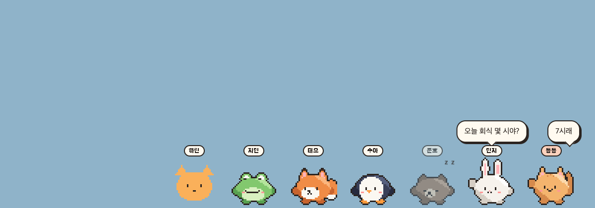
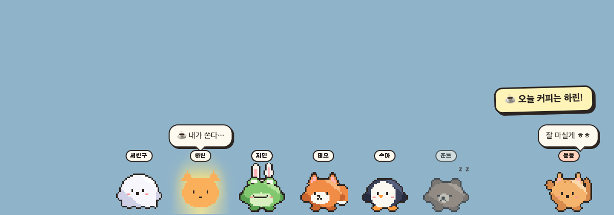
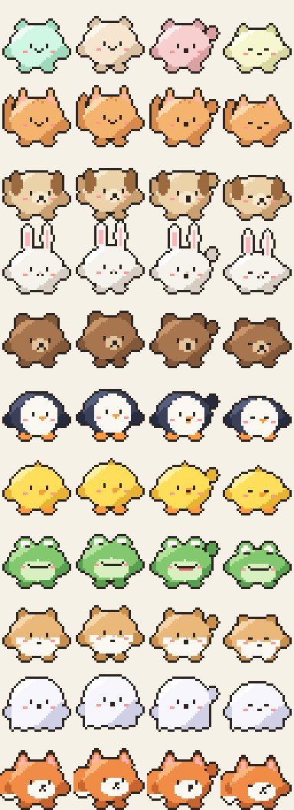
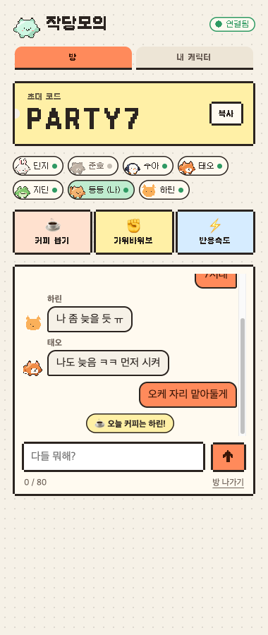
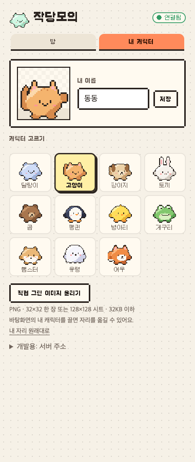

  

<h1 align="center">작당모의</h1>

  친구들 캐릭터가 내 바탕화면 아래에 모여 사는 앱 
  초대 코드 하나로 만드는 <b>바탕화면 단톡방</b> · macOS · Windows

  <a href="https://jakdang.naegoworks.com"><b>다운로드</b></a> ·
  <a href="https://github.com/donghyeun02/jakdang/releases/latest">최신 버전</a>

## 이런 앱이에요

- **방을 만들고 초대 코드를 단톡에 공유**하면, 들어온 사람들의 캐릭터가 모두 각자 화면 아래에 한 줄로 서요. 한 방에 최대 12명.
- 누가 말하면 **모든 사람 화면에서 그 사람 캐릭터 위에 말풍선**이 떠요.
- 내 캐릭터를 **마우스로 끌면** 자리를 옮길 수 있고, 친구들 화면에서도 그쪽으로 걸어가요.
- 새로 들어온 친구는 걸어 들어오고, 앱을 끈 친구는 화면에서 꾸벅꾸벅 졸아요.
- 캐릭터가 없는 곳은 클릭이 그대로 바탕화면으로 통과해서 작업을 방해하지 않아요.

## 미니게임

방에 접속한 사람이 2명 이상이면 할 수 있어요. 결과는 모든 화면에 똑같이 나와요.

| 게임 | 하는 법 |
| --- | --- |
| ☕ **커피 뽑기** | 스포트라이트가 캐릭터 사이를 튀다가 한 명한테 멈춰요. 오늘 커피는 그 사람이 쏘는 걸로. |
| ✊ **가위바위보** | 내 캐릭터 위에 뜬 ✊ ✌️ ✋ 중 하나를 10초 안에 골라요. |
| ⚡ **반응속도** | "지금!"이 뜨면 내 캐릭터를 클릭. 미리 누르면 부정출발이에요. |

## 캐릭터

픽셀 캐릭터 11종 중에 골라요: 말랑이, 고양이, 강아지, 토끼, 곰, 펭귄, 병아리, 개구리, 햄스터, 유령, 여우.
직접 그린 그림(PNG)을 올리면 같은 방 친구들한테도 그 그림으로 보여요. 그리는 방법과 규격은 [캐릭터 만들기 가이드](docs/CHARACTER_GUIDE.md)에 있어요.

  
  

## 시작하기

1. [다운로드 페이지](https://jakdang.naegoworks.com)에서 내 컴퓨터에 맞는 버튼을 눌러요.
   - **맥**: `.dmg`를 열고 작당모의를 응용 프로그램 폴더로 끌어다 놓기
   - **윈도우**: `.exe`를 더블클릭
2. 작당모의를 켜면 메뉴바(윈도우는 작업표시줄 오른쪽)에 아이콘이 생기고 설정 창이 열려요.
3. **새 방 만들기**를 누르고 초대 코드를 친구들에게 보내요. 친구들은 **초대 코드로 들어가기**에 입력하면 돼요.
4. 한 번 설치하면 컴퓨터를 켤 때 자동으로 실행돼요.

## 자주 묻는 것

처음 열 때 "확인되지 않은 개발자" 경고가 떠요

아직 앱 서명 전이라 그래요.
- 맥: 시스템 설정 → 개인정보 보호 및 보안 → 아래쪽의 "그래도 열기"
- 윈도우: "추가 정보" → "실행"

회사 컴퓨터에서도 되나요?

회사가 승인되지 않은 앱 실행을 막아뒀다면 쓸 수 없어요. 회사 보안 정책을 먼저 확인해 주세요.

친구가 내 화면을 볼 수 있나요?

아니요. 오가는 건 이름, 고른 캐릭터(또는 올린 그림), 캐릭터 위치, 짧은 메시지뿐이에요. 화면 내용은 절대 보내지 않아요.

누가 내 코드로 들어와서 나인 척할 수 있나요?

아니요. 앱마다 비밀 키가 있어서, 처음 그 코드를 쓴 기기만 그 코드로 접속할 수 있어요.

캐릭터가 작업하는 데 가려요

내 캐릭터는 마우스로 끌어서 옮길 수 있어요. 메뉴바 아이콘에서 앱을 잠깐 종료해도 돼요.

## 개인정보

- 서버는 방 중계를 위해 이름, 캐릭터(올린 그림 포함), 위치, 방 코드, 최근 메시지 30개(방마다)를 메모리에 들고 있어요. 서버가 다시 켜지면 사라져요.
- 기기 인증: 앱은 접속할 때 비밀 키를 보내 확인받고, 서버는 그 키의 **해시값**만 디스크에 저장해요. 키 원본은 저장하지 않아요.
- 서버는 서비스 운영을 위해 접속 수·메시지 수 같은 **숫자만** 날짜별로 세요. 이름, 코드, 메시지 내용, IP는 통계에 남기지 않아요.
- 다운로드 페이지는 방문 통계를 위해 Google Analytics를 사용할 수 있어요. 앱 자체에는 Google Analytics가 없어요.

## 개발에 참여하거나 직접 띄워보려면

- 개발 환경, 구조, 테스트: [docs/DEVELOPMENT.md](docs/DEVELOPMENT.md)
- 서버 배포: [docs/DEPLOY_NCLOUD.md](docs/DEPLOY_NCLOUD.md)

## 라이선스

- **코드**: [PolyForm Noncommercial 1.0.0](LICENSE). 공부, 개인 사용 같은 비상업적 용도로는 자유롭게 쓸 수 있고, 상업적으로 쓰려면 허락이 필요해요.
- **캐릭터·그림·디자인**: All rights reserved. [LICENSE-ASSETS.md](LICENSE-ASSETS.md)
- **외부 저작물**(갈무리 폰트 등): [THIRD_PARTY_NOTICES.md](THIRD_PARTY_NOTICES.md)

© 2026 naego works
